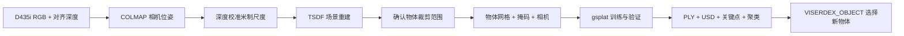

# D435i 实物扫描 → 3DGS → ViserDex

入口为 `bash scripts/scan_object.sh`。面向**物体固定、移动相机绕物体拍摄**，
先建立可检查的米制几何，再训练只包含物体的 Gaussian 模型。
相机的 IMU 不直接提供六自由度轨迹；这里用 COLMAP 估计相机位姿，D435i 对齐深度恢复尺度。



## 环境

扫描模块不依赖 Isaac Sim。采集在连接 D435i 的机器执行；重建使用 CPU，3DGS 训练使用 CUDA。
完整数据保存在 `logs/scanning/`，不会提交进 Git。新的 `.venv-scan` 环境与策略训练环境分开。

```bash
cd viserDex_revo3

# 可复用已有 CUDA PyTorch 环境来减少重复安装：
VISERDEX_SCAN_BASE_PYTHON=/path/to/cuda_environment/bin/python bash scripts/setup_scan.sh

# 或从系统 Python 创建独立完整环境（需要足够磁盘空间，安装 CUDA 13.0 PyTorch）：
bash scripts/setup_scan.sh

# 仅采集的机器可选：
bash scripts/setup_scan.sh --capture-only

# 只查询设备，不启动相机视频流：
bash scripts/scan_object.sh doctor --camera
# 实际测试 CUDA rasterizer 的前向与反向；首次会编译扩展：
bash scripts/scan_object.sh doctor --cuda --rasterizer
```

`VISERDEX_SCAN_PYTHON` 可以指定另一个 Python；`CUDA_HOME` 指向与 PyTorch CUDA 主版本匹配的工具链。
脚本默认使用 `/usr/local/cuda`（存在时），`MAX_JOBS=2` 限制首次编译的 CPU/内存压力。
RTX 50 系列需要支持 Blackwell 的 PyTorch/CUDA。其他 GPU 由 PyTorch 自动选择编译架构。

USB 2 默认请求 640×480、15 Hz；USB 3 默认 30 Hz。SDK 在开始前检查请求的流组合，
不支持时给出错误，可用 `--fps 6` 降低带宽。正式采集建议接 USB 3 接口和数据线。
帧选择默认每 0.5 秒保留一张，并记录清晰度、有效深度比例和 RGB/深度时间戳。

## 1. 采集

把物体放在稳定、有纹理的背景上，保持灯光稳定，缓慢移动相机拍摄一圈，
再换较高视角补拍一圈。整个序列中物体和背景都应静止；不要中途翻动物体。
桌面纹理用于相机追踪，后续裁掉。距离以物体上有足够有效深度、RGB 清晰为准。
透明、强反光和低纹理物体可能需要额外处理，重建质量需实测。

```bash
bash scripts/scan_object.sh capture \
  --output logs/scanning/my_object/capture \
  --frames 240 --duration 180 --preview
```

连接多台相机时，用 `--serial <device_serial>` 选择设备。启动后预热 3 秒，再自动保存帧；按 Q/Esc 或 Ctrl-C 结束。至少 30 张有效帧才标记采集完成。
输出包括 RGB PNG、16 位对齐深度 PNG、原始标定、整流后的 PINHOLE 内参、深度单位及 `scan.json`。
RGB 和深度使用同一整流映射（深度采用最近邻），深度是光轴 Z，不是到相机中心的径向距离。
支持 Brown-Conrady 或零畸变；不支持的非零畸变模型会明确停止。

已有目录拒绝覆盖。采集失败时保留已经保存的图像和错误状态。
当前只支持 SDK 在线采集及本格式的数据集，没有 `.bag` 或转台模式导入器。

## 2. 重建与尺度检查

```bash
bash scripts/scan_object.sh reconstruct \
  --scan logs/scanning/my_object/capture \
  --output logs/scanning/my_object/reconstruction --depth-max 1.0
```

固定标定内参进行 SIFT 特征提取、匹配和增量 SfM。默认 `--matcher auto` 在不超过 300 张图像时
使用全匹配，较长序列使用顺序匹配；跨圈匹配不足时可显式用 `--matcher exhaustive`
（需要新的输出目录，计算量随图像数量平方增长）。默认要求最大连通模型注册至少 80% 图像。
重建保留背景特征，不依赖小物体表面有足够纹理。

尺度由多视图稀疏点在相同像素的 `RealSense Z / COLMAP Z` 鲁棒估计，过滤深度边缘、
无效深度和离群值；至少 100 个一致对应及 3 个有深度证据的视图。
跨视图尺度不一致或注册不足会停止。结果写入 `reconstruction.json`，含尺度证据和被采用的帧。

`scene.ply`、`scene_mesh.ply`、相机位姿均使用**第一张注册图像的光学坐标系**，
单位米：X 向右、Y 向下、Z 向前。查看 `anchor_image`，不能假设一定是采集的第一张。

## 3. 裁出物体

先查看场景坐标并确认边界：

```bash
bash scripts/scan_object.sh inspect --reconstruction logs/scanning/my_object/reconstruction --viewer
```

Open3D 窗口中 Shift+左键拾取参考点，Q 退出后打印坐标。根据这些坐标设置下面的六个边界值。
`--bounds` 是 `xmin ymin zmin xmax ymax zmax`，示例数值**必须按实际扫描修改**。
倾斜桌面可额外传 `--plane nx ny nz d`，只保留满足 `n·X+d > 0.003 m` 的一侧。
平面也在上述重建坐标系中；这里不自动猜测哪一块平面是桌面。

```bash
bash scripts/scan_object.sh prepare \
  --reconstruction logs/scanning/my_object/reconstruction \
  --output logs/scanning/my_object/prepared \
  --bounds -0.06 -0.06 0.24 0.06 0.06 0.36
```

检查输出中的 `mask_preview_*.jpg` 和 `mesh.ply`；掩码应完整覆盖物体，并排除支撑物和桌面。
RGB-D 投影生成逐视图掩码，保留最大连通区域，只填补小深度孔洞。
对物体深度重新 TSDF 融合，得到网格和带颜色的 Gaussian 初始点。
不把没有拍到的底面伪装成完整扫描；`mesh_watertight` 记录网格是否封闭。
薄片、多部件或严重深度缺失物体可能不适合当前最大连通区域策略。

网格包围盒中心平移到原点；同一个变换应用到网格、点云和相机。
此步骤不旋转坐标轴、不额外归一化大小，变换写入 `dataset.json`。
如果要改裁剪，使用新 prepared 目录重新执行，后面的训练与导入也使用新目录。

## 4. 训练 3DGS

```bash
bash scripts/scan_object.sh train \
  --dataset logs/scanning/my_object/prepared \
  --output logs/scanning/my_object/training \
  --iterations 7000 --max-gaussians 50000
```

使用 gsplat 1.5.3 的 rasterizer 和 MCMC densification，保持米制物体坐标。
损失包含前景 RGB、背景、SSIM、轮廓、有效深度和 opacity 正则；背景颜色随机化。
三阶球谐逐渐启用；图像缓存在 CPU，每次只向 GPU 传一张。显存不足可设置 `--downsample 2`。
`--max-gaussians` 同时限制初始化点数与 densification 上限。

输出：`splat.ply`、`checkpoint.pt`、`metrics.jsonl`、`progress.json`、`completion.json`、
`evaluation.json` 及验证对比图（左原图合成前景，右渲染）。
每 8 帧留出一帧不做外观训练；位姿和 TSDF 使用了全部视图，因此验证不是完全独立的几何测试。
验证报告全图 PSNR、前景 PSNR、掩码 IoU，针对的是最终裁剪并导出的精确 splat。
达到训练预算表示流程完成，不能自动认定扫描质量达标。

SIGINT/SIGTERM 在当前迭代后保存检查点并写 `completed=false`；后续导入会拒绝。
目前检查点用于检查参数和保留优化状态，**未提供训练恢复命令**；可用新输出目录重新训练。

可以将整个 prepared 文件夹拷到另一台有 CUDA 的机器运行同一训练命令。
prepared 文件夹自包含；训练不需要原始采集数据或相机。完成后取回 training 文件夹再导入。

## 5. 导入项目

用实际称量的质量（kg）导入，例如：

```bash
bash scripts/scan_object.sh import \
  --dataset logs/scanning/my_object/prepared \
  --training logs/scanning/my_object/training \
  --name MyScannedObject --mass-kg 0.05
```

默认输出到 `source/viserdex/viserdex/assets/data/scanned/MyScannedObject/`：

- `splats/splat.ply`：三阶 SH 的标准 3DGS PLY，含 45 个 `f_rest_*`、log scale、opacity logit 和 WXYZ 旋转。
- `meshes/object.ply`、`usd/object.usda`：同坐标米制网格，USD 设刚体、显式质量和凸包碰撞。
- `keypoints/points_8.pt`：8 个包围盒虚拟关键点；项目观测再添加原点，共 9 点。
- `splats/clusters/indices/*.pt`：位置、颜色、尺度、旋转聚类索引，供现有增强器读取。
- `object.json`、`provenance.json`：可移植相对路径注册信息、源文件校验和、单位与训练验证记录。

凸包碰撞会填平凹陷；当前没有凸分解或自动惯性辨识。仿真前应检查碰撞形状、质量、尺寸。
导入拒绝覆盖已有物体；只有全部文件生成并校验后才发布 `object.json`。
`assets/objects.py` 自动加载这些 manifest，原有物体名字不能被新资产覆盖：

```bash
export VISERDEX_OBJECT=MyScannedObject
# 在配置好 Isaac Sim/Isaac Lab 的机器检查原生与 Gaussian 渲染对齐：
bash scripts/run_sim6.sh scripts/preprocessing/check_gs_camera.py --headless --num_envs 1
```

自定义测试资产目录可用 `--assets-dir /path/to/scanned`，然后设置 `VISERDEX_SCANNED_ASSETS_DIR`。
`object.json` 使用相对路径，整个物体文件夹可直接搬到远端项目的 `assets/data/scanned/`。
新物体的 teacher/pose checkpoint 字段保持未设置；它需要相应策略和位姿网络训练，不能自动复用方块模型。

## 配置串联与验证

`config/scan_pipeline.example.json` 展示各阶段参数。先修改采集路径、裁剪范围、物体名和实际质量，
再从项目根目录执行 `bash scripts/scan_object.sh process --config /path/to/config.json`。
相对路径以调用时的工作目录为准。阶段按 reconstruct → prepare → train → import 顺序执行，
任何阶段失败都会停止，并写同名 `.status.json`。已有输出目录拒绝覆盖；继续时从配置中删除已完成阶段，
只运行剩余阶段，或为要重跑的阶段指定新的输出目录。

CPU/文件协议测试：

```bash
PYTHONNOUSERSITE=1 .venv-scan/bin/python -m pytest tests/test_scanning.py -q
```

合成数据可用 `synthetic --output logs/scanning/fixture --views 48` 生成，
并沿同一 reconstruct/prepare/train/import 路径验证。`ground_truth.json` 只用于检查和确定裁剪，
重建程序不读取其中的相机位姿。真实 D435i 采集质量仍需之后实际环绕拍摄验证。

也可以一条命令重跑完整合成验证（含实际 CUDA 训练和项目原有 PLY 加载器检查）：

```bash
bash scripts/scan_object.sh smoke --output logs/scanning/smoke_new --iterations 600
```

测试物体仅导入该次 smoke 输出内的 `assets/`，不会加入默认物体列表。
`validation.json` 记录相机位姿误差、留出图像指标及实际验证边界。

2026-10-17 本机完整合成验证已通过（`logs/scanning/smoke_full_20261017/validation.json`）：
48/48 视图注册，相机位置平均误差 0.361 mm、最大误差 0.669 mm；
实际完成 600 步 CUDA 优化，前景 PSNR 14.276 → 20.051 dB，最终掩码 IoU 0.9887。
导出的 11,450 个高斯、8 个关键点及所有聚类索引由项目原有加载器成功读取，
USD 经 OpenUSD 重载验证。扫描测试和相关资产/视觉回归共 28 项通过。
两圈不同高度的合成序列在纯顺序匹配下仅注册 52.1% 图像，已被 80% 门槛阻止；
因此默认小数据集使用全匹配，并保留匹配方式与注册率记录。
这些是合成数据与文件接口结果；尚未录制真实物体，也未执行 Isaac Sim 中的刚体落地/相机对齐测试。

实现依据：

- [RealSense 官方深度对齐示例](https://github.com/realsenseai/librealsense/blob/master/wrappers/python/examples/align-depth2color.py)
- [RealSense 投影与深度单位说明](https://github.com/realsenseai/librealsense/wiki/Projection-in-RealSense-SDK-2.0)
- [COLMAP 官方 Python 重建示例](https://github.com/colmap/colmap/blob/3.13.0/python/examples/example.py)
- [Open3D RGB-D TSDF 融合](https://www.open3d.org/docs/release/tutorial/pipelines/rgbd_integration.html)
- [gsplat v1.5.3 官方训练示例](https://github.com/nerfstudio-project/gsplat/blob/v1.5.3/examples/simple_trainer.py)
- [gsplat densification API](https://docs.gsplat.studio/main/apis/strategy.html)
