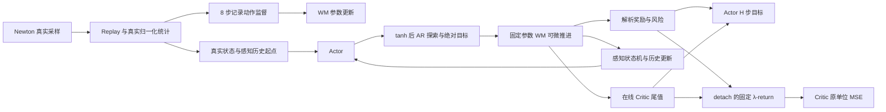

# Revo3 SuperMimic v32：网络、控制、学习流程与实验详细说明

更新日期：2026-11-06。本文描述当前 **SuperMimic v32 / paper Critic** 分支；不包含 FlashSAC 的网络、损失或训练流程。

本文按当前源码、实际长训配置及保存的评估证据重写。配置基准是 [v32 实验 config.json](/home/brainco/reorientation/training/runs/die50_47g_papercritic_v32_20261106_032925/config.json)，不是 `Config` 中为旧检查点保留的默认值。旧版逐次排查记录保留在 [v30/v31 历史说明](/home/brainco/reorientation/source_home/brainco1/workspace/xinyu/viserDex_revo3_20261102/docs/revo3_network_v30_zh.md)。

**当前结果：** 50 mm、47 g 骰子的 v32 长训计划为 10,000 轮，最后完整记录为第 2552 轮，随后采样时因实际关节机械越限失败退出。在线线性 Critic 与想象 λ-return 已实现并通过训练接口验证，但没有解决 WM 多步误差和 bootstrap 梯度主导。不能把“改回论文式 Critic”写成“控制问题已经解决”。

## 1. 版本、任务与实现边界

| 项目 | 当前值 / 行为 |
|---|---|
| 检查点版本 | `32` |
| 网络合同 | `hardware_center25_v3` |
| 观测协议 | `revo3_manual_convex_single_pose_encoder_rot6d_no_clock_v5` |
| 状态协议 | `single_pose_last_action_delayed_pd_no_clock_v2` |
| Critic 协议 | `imagined_lambda_linear_online_critic_MSE_no_EMA_v32` |
| 想象协议 | `absolute_position_imagined_lambda_linear_online_critic_mse_v32` |
| 主要开关 | `paper_critic=True`、`stable_value_learning=True`、`absolute_policy_optimization=True` |
| 任务 | 从固定掌内初态到随机旋转目标，随后持续保持 |
| 位置跟踪 | `track_object_position=False`；位置仍进入状态、观测和掉落判定 |
| 物体稳定性奖励 | `stability_reward_scale=0`；速度以单独代价处理 |
| 几何网络输入 | `geometry_enabled=False`；当前 Actor/WM/Critic 未接入 ContactSDF |
| 运行物理栈 | Isaac Lab v3.0.0、Isaac Sim 6.2.0.0、Newton 1.6.1、Warp 1.17.0，`newton_mjwarp` |

`stable_value_learning=True` 在这里仍选择风险变换与 Actor 目标，但不表示存在有界价值网络：`uses_target_critic = stable_value_learning and not paper_critic`，因此 v32 为 False。

恢复的范围是 SuperMimic 式（3）的在线价值关系、想象 λ-return、固定监督目标和原单位 MSE。五头风险、任务奖励、HOME 初始化、物理角度探索、辅助 WM 损失与 H=8 都是本项目的任务设定；本实现不是原论文整套实验的逐项复现。

## 2. 骰子、固定初态和目标生命周期

### 2.1 骰子与坐标

当前物体是 `die50_47g`：50 mm 圆角骰子，标称质量 **0.047 kg**，质量来自用户给定。旧的 `die50` 100 g 资产保留用于历史兼容，不是本次训练资产。

47 g 版保持 50 mm 形状；惯量按旧 100 g 版乘以 0.47。这依赖内部质量分布不变的假设，不是实测惯量。物体质量随机化倍率为 0.8–1.2，实际训练质量为 37.6–56.4 g。

网络内物体位置、线速度、角速度、旋转均表达在手基座坐标系；四元数统一为 **XYZW**。手局部 +X 对齐重力反方向，不能把基座 Z 自动理解为掌面法向。姿态特征取旋转矩阵前两列，按列依次展平为 6D。

掌心参考点 `hand_center_base_m=(0.055, -0.010, 0.100)` m，用于位置输入中心化和掉落距离。它与骰子初始中心不同。

### 2.2 reset 写入同一套匹配状态

reset 使用 `fixed_palm_v1`，直接写入：

- 固定托举 HOME；所有关节速度为 0，手基座速度为 0。
- 骰子相对手基座位置 `(0.0342517340, -0.00856294875, 0.1016880128)` m。
- 骰子相对手基座四元数 `(0.0368518044, 0.6479978003, 0.0275238387, 0.7602520856)`，XYZW。
- 骰子线速度、角速度均为 0。
- 清空控制延迟队列和探索状态；新 episode 的观测历史用首帧重复填充。

不同环境只通过各自手基座变换得到世界坐标。不存在每次随机手形、横向位置或初始朝向，也不存在 reset 时随机找接触点、额外下落、隐式 settling 或托举外力。固定姿态来源于离线检查的掌内支撑配置；运行时仍检查实际写入状态与几何。

固定初态不等于取消域随机化，也不等于保证任意后续控制都稳定。v32 预热的零掉落支持这一配置在该实验的 HOME 小幅运动下可用，不能外推为所有策略都不会掉落。

### 2.3 目标、成功、掉落与超时

目标朝向在 reset/显式新命令时随机生成；成功或经过 10 s 不会自动换目标。当前采样器将两个独立 `[-π,π]` 的 X/Y 旋转相乘，**不是均匀 SO(3) 采样**。目标在世界坐标生成，再转换到网络使用的基座坐标。

成功要求姿态误差严格小于 0.1 rad、物体角速度严格小于 0.5 rad/s，连续满足 13 个控制采样，即 0.52 s；每个目标只记一次成功事件。当前关闭位置跟踪，因此成功条件不额外要求位置/线速度阈值；掉落和超时仍阻断成功。成功事件本身不发放额外奖励，也不结束 episode。

掉落为物体中心到掌心参考点距离超过 0.3 m。episode 时间上限为 20 s，即 500 个控制步。`goal_evaluation_s=10` 只用于统计，既不是终止边界，也不是 Actor 输入。时间上限是 truncation，不是物理失败；WM 终止标签使用 `terminated`，不能用 `done` 代替。

## 3. 21 维关节顺序、绝对目标与硬件边界

### 3.1 顺序与 HOME

Actor 输出、编码器限位、速度、上一动作、Kp/Kd 都按下表的硬件顺序排列。HOME 数字为几何角；网络输出的是编码器绝对角。两者关系为 `q_geom = q_enc + bias`，只有 thumb CMP 的固定 bias 为 +1°，其他为 0。

| 索引 | 关节（共同前缀 `right_`） | 编码器范围（°） | 几何 HOME（rad） |
|---:|---|---:|---:|
| 0 | little_MPR | -30 – 10 | 0 |
| 1 | little_MCP | -5 – 90 | 0.55 |
| 2 | little_PIP | -10 – 90 | 0.85 |
| 3 | little_DIP | -20 – 90 | 0.475 |
| 4 | ring_MPR | -25 – 20 | 0 |
| 5 | ring_MCP | -5 – 90 | 0.55 |
| 6 | ring_PIP | -10 – 90 | 0.85 |
| 7 | ring_DIP | -20 – 90 | 0.475 |
| 8 | middle_MPR | -20 – 25 | 0 |
| 9 | middle_MCP | -5 – 90 | 0.55 |
| 10 | middle_PIP | -10 – 90 | 0.85 |
| 11 | middle_DIP | -20 – 90 | 0.475 |
| 12 | index_MPR | -10 – 30 | 0 |
| 13 | index_MCP | -5 – 90 | 0.55 |
| 14 | index_PIP | -10 – 90 | 0.85 |
| 15 | index_DIP | -20 – 90 | 0.475 |
| 16 | thumb_MCP | 0 – 75 | 0.325 |
| 17 | thumb_PIP | -10 – 90 | 0.325 |
| 18 | thumb_DIP | -20 – 90 | 0.2375 |
| 19 | thumb_CMP | -1 – 109 | 1 |
| 20 | thumb_CMR | 0 – 106 | 0.65 |

这些范围来自当前训练合同的 URDF 可用范围，不能直接替换成旧 SDK 软件限位。thumb CMP 的编码器范围 −1°–109° 加 bias 后，对应几何范围 0°–110°。该 +1° 是已有辨识模型的固定假设，尚不是本任务重新标定的结果。

### 3.2 一次 tanh 与一次仿射解码

对第 j 个关节，令编码器限位为 `l_j,u_j`，中心 `m_j=(l_j+u_j)/2`，半宽 `h_j=(u_j-l_j)/2`：

\[
z_t=\pi_\theta(o_{t-9:t}),\qquad a_t=\tanh z_t,
\qquad q^{enc}_{target,t}=m+h\odot a_t.
\]

真实仿真动作层再加固定 encoder bias，送给几何坐标下的 DelayedPD。WM 输入的 target 仍为编码器角，预处理把它映射回归一化坐标。

这是绝对位置输出，没有增量积分器、残差 HOME 控制、目标 EMA、硬性限速投影或额外动作平滑。有限 logits 对应开区间内目标，URDF 范围没有被人为缩小。

HOME 初始化将 Actor 最后一层权重置零，bias 设为 `atanh((HOME_geom-bias-m)/h)`。因此初始确定性 Actor 对任意观测都给出同一个合法 HOME，避免随机网络把第一步目标送到范围中心附近。初始化只解决起点，不约束训练后 Actor 的目标变化。

### 3.3 时序和限幅的实际含义

| 项目 | 数值 | 实际作用 |
|---|---:|---|
| 策略频率 | 25 Hz / 40 ms | 每个策略步下发一次目标 |
| PD 频率 | 200 Hz / 5 ms | 每个策略步执行 8 个 PD tick |
| Newton 求解子步 | 2 / PD tick | 2.5 ms，即 400 Hz |
| 控制延迟 | 3 个 PD tick | 15 ms，使用延迟队列 |
| 执行器输出扭矩 | ±1.28 N·m | DelayedPD 实际裁剪；不裁剪约束反力 |
| 声明的关节速度限值 | 100 rpm = 600°/s | Newton 此接口不强制执行这一速度限制 |
| 学习用关节速度阈值 | 90°/s | 软代价阈值，没有硬限速效果 |
| 学习用目标变化率阈值 | 60°/s = 2.4°/策略步 | 软代价阈值，没有目标 slew limiter |
| 机械越限保护 | URDF 几何限位外额外 5° | 触发 fatal，保存现场，在异常 transition 写入 replay 前退出 |

上一动作与 `delay_ready` 足以描述当前固定 15 ms / 40 ms 时序中的跨控制步命令记忆；reset 后空队列不能被误当成“上一目标为归一化零”。`delay_ready=0` 时，第一步目标速率代价以实际初始编码器位置为参照。

## 4. 探索噪声、感知噪声与预热激励

### 4.1 当前探索噪声在 tanh 后

当前绝对位置分支使用物理角度 AR(1) 探索。令 `ε` 的单位为 rad：

\[
\rho=e^{-0.04/0.2}\approx0.81873,\quad
\epsilon_t=\rho\epsilon_{t-1}+\sigma\sqrt{1-\rho^2}\xi_t,
\quad \sigma=0.5^\circ,\quad\xi_t\sim\mathcal N(0,I).
\]

先得到 `a=tanh(z)`，再加 `ε/h`，最后用反射函数回到合法范围：

\[
\tilde a=1-\left|\operatorname{remainder}(a+\epsilon/h+1,4)-2\right|.
\]

真实采样和可微想象都使用这一路径。反射前噪声的稳态标准差为 0.5°；固定策略输出时，稳态相邻噪声差的标准差约 0.301°，小于 2.4°/步的目标速率阈值，但高斯噪声并没有严格最大幅度保证。相关的是探索偏移，不是把策略绝对目标低通滤波。

Replay 保存实际送入仿真的动作，以及采样前的 `exploration_noise_rad`，想象从对应 AR 状态继续；reset 清零。评估/录像关闭动作探索，直接使用 `tanh(z)`。

代码中仍有 `Actor.sample()` 的 **tanh 前** 噪声实现及旧字段 `exploration=0.1`，用于历史分支。当前 `absolute_policy_optimization=True` 的训练不会使用该路径。不能只看到该函数就判断当前探索位置。

### 4.2 感知随机化是另一条路径

Actor 经过持有采样、偏置、噪声和异常测量得到观测；WM/Critic 使用真实特权状态。当前感知参数：

| 项目 | 当前定义 |
|---|---|
| 编码器白噪声 | 归一化关节坐标高斯 std=0.005 |
| 编码器 episode 偏置 | 归一化关节坐标高斯 std=0.01 |
| 编码器额外观测延迟 | 最大 0 个策略步；与 15 ms 执行器延迟不同 |
| 位置白噪声 / 偏置 | 各轴均匀 ±0.012 m / ±0.012 m |
| 旋转白噪声 / 偏置 | 旋转向量各轴均匀 ±1° / ±0.1° |
| 位置/旋转更新周期 | 分别在 1–3 个策略步中抽样，未更新时保留上一测量 |
| 更新抖动概率 | 每 episode 从 `[0,0.1]` 抽样 |
| 异常测量概率 | 每 episode、位置/旋转通道分别从 `[0,0.3]` 抽样 |
| 异常测量 | 位置替换为基座坐标各轴 ±0.15 m；旋转替换为随机单位四元数 |

`failure_probability=0.3` 是随机概率的上界，不是每帧固定 30%。观测可微路径重用同一 sensor 状态机；任务辅助监督使用 clean observation，不把随机感知误差当成物理预测标签。

### 4.3 小幅预热

前 1000 个训练迭代只训练 WM。真实采样由 `HomeExcitation` 提供固定 HOME 附近的随机目标：每关节不超过 ±2°，靠近限位时以 HOME 可用裕量的 95% 收缩；使用五次 smoothstep 插值，每段 30 个间隔，约 1.2 s；各环境 reset 后从 HOME 重新开始。

最后 20% 预热用平滑包络回到 HOME，再交给仍为 HOME 初始化的 Actor。预热不叠加常规 AR 探索；它不改变 reset 的手形和物体位姿。

v32 预热 **Actor 更新数=0、Critic 更新数=0**。旧 TD/BCE/EMA 分支曾在预热训练真实 TD Critic，这不适用于 v32。小幅预热提供的是 HOME 附近动力学覆盖，不足以保证模型掌握之后的大幅接触切换。

## 5. 状态、观测、context 和网络输入

所有索引使用 Python 半开区间 `[start:end)`。不能把 compact state、Actor 单帧观测和网络编码后的物理特征混为一谈。

### 5.1 Compact state：84 维

| 索引 | 维数 | 内容 / 单位 |
|---|---:|---|
| 0:21 | 21 | 几何关节角 q，rad，硬件顺序 |
| 21:42 | 21 | 关节速度，rad/s |
| 42:45 | 3 | 物体中心，基座 m |
| 45:49 | 4 | 物体旋转 XYZW |
| 49:52 | 3 | 物体线速度，基座 m/s |
| 52:55 | 3 | 物体角速度，基座 rad/s |
| 55:76 | 21 | 上一实际归一化动作，包含当时探索 |
| 76:79 | 3 | 目标位置，基座 m |
| 79:83 | 4 | 目标旋转 XYZW |
| 83:84 | 1 | `delay_ready`：reset 为 0，执行控制后为 1 |

前 55 维是物理核心。状态不包含任务时钟、成功累计或 hold counter；这些由真实任务管理器维护。WM 不预测上一动作、目标或 delay flag，由确定的状态推进逻辑写入。

### 5.2 Actor：81 维单帧 × 10 帧 = 810 维

| 索引 | 维数 | 进入固定仿射前的观测 |
|---|---:|---|
| 0:21 | 21 | 带感知噪声的归一化编码器位置 |
| 21:42 | 21 | 关节速度 ×0.1 |
| 42:63 | 21 | 上一实际归一化动作 |
| 63:66 | 3 | 感知物体位置，基座 m |
| 66:69 | 3 | 目标位置，基座 m |
| 69:75 | 6 | 感知物体旋转 6D |
| 75:81 | 6 | 相对旋转 `R_object R_goal^T` 的 6D |

时间从旧到新排列，最新帧位于末尾；先对每帧的同名特征归一化，再展平。10 帧在 25 Hz 下相邻间隔 40 ms，首尾跨度 0.36 s。Actor 不直接看到物体线/角速度、接触力、质量/Kp/Kd、delay flag 或几何 SDF。

### 5.3 物理特征 57 维与 context 65 维

物理特征是 `[q(21), qdot(21), p(3), R6D(6), v(3), omega(3)]`。四元数 4 维替换成旋转 6 维，所以从物理核心 55 维变成 57 维。

| context 索引 | 内容 |
|---|---|
| 0:21 | 21 个随机化运动连杆的实时质量 |
| 21:22 | 物体实时质量 |
| 22:23 | 物体摩擦系数 |
| 23:44 | 21 个关节 Kp，硬件关节顺序 |
| 44:65 | 21 个关节 Kd，硬件关节顺序 |

连杆质量顺序来自 context manifest 的 body names，**不是硬件关节顺序**。不得将质量向量按 little→ring→middle→index→thumb 自行重排。手固定几何、固定摩擦和由质量确定的惯量不另行重复作为 context 输入。

### 5.4 WM 输入 165 维，Critic 输入 153 维

| 网络 | 索引 | 内容 |
|---|---|---|
| WM | 0:57 | 物理特征 |
| WM | 57:78 | 本次编码器绝对目标 |
| WM | 78:99 | 上一实际归一化动作 |
| WM | 99:100 | delay_ready |
| WM | 100:165 | context |
| Critic | 0:57 | 物理特征 |
| Critic | 57:78 | 上一实际归一化动作 |
| Critic | 78:81 | 目标位置 |
| Critic | 81:87 | 相对旋转 6D |
| Critic | 87:88 | delay_ready |
| Critic | 88:153 | context |

WM 不需要目标姿态才能预测受控物理动力学；目标只在奖励/代价 readout 和 Actor 闭环中起作用。旧文档的 WM=164、Critic=152 漏掉了当前启用的 `delay_ready`，不适用于本配置。

## 6. 输入缩放与 RunningNorm：速度 ×2 到底在哪里

固定仿射之后，每个网络使用独立 RunningNorm；统计量只由真实仿真数据显式更新，不由想象轨迹更新。

| 量 | Actor 的固定处理 | WM / Critic 的固定处理 |
|---|---|---|
| 关节位置 | 观测构造时已归一化 | 几何角减 encoder bias，再按完整编码器限位归一化 |
| 关节速度 | 观测构造时 ×0.1 | ×0.1 |
| 物体/目标位置 | `(p-hand_center)×10` | 对各自包含的位置同样处理 |
| 物体线速度 | 没有直接输入此量 | ×2 |
| 物体角速度 | 没有直接输入此量 | ×0.1 |
| WM 当前 target | 不适用 | 按编码器限位归一化 |
| 旋转 6D、上一动作、delay flag | 不额外缩放 | 不额外缩放 |
| context | 不输入 | 先除以初始化时各环境该通道绝对值均值，下限 `1e-12` |

随后计算：

\[
\operatorname{Norm}(x')=\frac{x'-\mu}{\max(\sqrt{\mathrm{variance}+\epsilon^2},\,\mathrm{floor})},
\qquad\epsilon=0.01.
\]

三个网络的关节速度通道均设 `floor=0.1×π/2≈0.15708`，防止 HOME 小幅预热导致速度样本方差极小、稍大的速度被过度放大。其他输入没有这个物理速度 floor。没有对观测值做硬裁剪；计数达到 2×10^8 后停止更新统计。

**线速度 ×2 没有被删除，仍在 WM/Critic 输入预处理中。** 它不会把物理模拟速度、真实奖励或代价里的速度变成两倍。若方差足够大、忽略 epsilon，固定正比例缩放会在后续标准化中基本抵消；方差很小或初始化阶段则不会完全抵消，因此它也不能被称为“完全无影响”。目前没有消融实验证明 ×2 是最优选择。

应当区分三类尺度：网络输入仿射、物理误差监督的归一化分母、Actor 奖励/代价的目标权重。它们影响不同路径，不能把一项 input scale 当成奖励权重。

## 7. 三个网络的结构和输出

下表参数量由实际 `config.json` 构造模型计算，只计可训练参数，不计 RunningNorm 等 buffer。

| 网络 | 结构 | 激活 / 归一化 | 可训练参数 |
|---|---|---|---:|
| Actor | 810 → 1024 → 512 → 256 → 21 | 隐层 ELU；输出单次 tanh | 1,491,989 |
| WM 物理主干 | 165 → 2048 → 2048 → 2048 → 54 | 每个隐层 Linear → LayerNorm → SiLU；输出线性 | 8,855,606 |
| WM 终止头 | 57 → 64 → 64 → 1 | 隐层 ELU；输出 logit | 7,937 |
| WM 合计 | 物理主干 + 终止头 | 两者共同训练 | 8,863,543 |
| Critic | 153 → 512 → 256 → 128 → 6 | 隐层 ELU；六个线性输出 | 243,846 |

Actor 不使用 RNN/Transformer，时序信息来自展平的观测历史。WM 是确定性残差动力学网络，不输出预测方差/模型不确定度，也没有 ensemble。Critic 是状态价值 V，不是依赖当前 action 的 Q 网络。

### 7.1 WM 的 54 维输出

输出为 `[Δq(21), Δqdot(21), Δp(3), Δrotation_vector(3), Δv(3), Δomega(3)]`。先用真实 delta 统计反归一化，再积分成 55 维物理下一状态：

\[
q_{obj,t+1}=\operatorname{normalize}\left(\operatorname{Exp}(\Delta\phi_t)\otimes q_{obj,t}\right).
\]

旋转增量由 `Log(q_next ⊗ conjugate(q_current))` 定义，是基座表达的相对旋转向量，不能直接把四元数各元素做加法。其余物理量做残差相加。`delta_norm` 的 epsilon 为 `1e-4`；输出反归一化不使用 WM 损失的物理 floor。

物理主干末层权重/bias 初始为 0；真实 delta 均值更新后，零网络输出对应统计均值增量，不能一直理解为严格静止。终止头初始 bias 约 −4.595，对应约 1% 失败先验；后续由真实失败标签训练。

### 7.2 Critic 六头

顺序为 `[reward, joint_speed, target_rate, object_angular_speed, object_linear_speed, drop]`。各头估计各自折扣回报，**输出无界**；没有 sigmoid、softplus、BCE 或 EMA target Critic。末层权重/bias 均初始化为 0。

## 8. 真实数据、Replay 与 WM 学习

### 8.1 采样和 reset 边界

Replay 保存状态、真实感知历史、sensor memory、实际 action、探索 AR 前态、真实 reward、`done/terminated`、reset 前的 `next_physical` 等。当前共享 adapter 还记录 `truncated`；SuperMimic 的终止监督仍读取 `terminated`。

终止步的下一物理状态在自动 reset **之前**捕获。长度 8 的 WM 窗口包含终止 transition，但 mask 去掉它之后的后缀，不把新 episode 的 HOME 作为旧 episode 的动力学下一状态。超时同样切断真实窗口，但不作为物理掉落标签。

当前 replay 为 GPU 环形缓冲，1000 个向量控制步 × 1024 环境，容量 1,024,000 个 transition。每个训练迭代开始采集平均 2.5 个向量控制步；`utd=0.4` 的含义是迭代数/向量控制步，不是每个单环境 transition 做 0.4 次完整更新。

### 8.2 WM 自适应采样

当前 `adaptive_replay=True`，WM 的 8 步窗口按 `20% uniform + 80% priority^0.6` 混合分布抽样，使用 `1/(N·P)` importance weight 修正监督期望。priority 来自真实窗口误差；generation token 防止过期采样结果覆盖已复用槽位。

Actor 起点是均匀单 transition 抽样，不沿用 WM 的优先级偏置。adaptive 模式关闭独立事件 archive；配置中保留的 `event_capacity=4096`、`event_fraction=0.25` 不是当前运行的额外 25% 掉落采样。

### 8.3 WM 8 步开环监督

从真实状态出发，用记录的 8 个实际动作递推 WM；中间不拿真实物理状态覆盖预测状态。一步预测误差分为六组，各组先对维度平均、再对六组平均，避免 21 维关节组仅因维数压倒 3 维物体组。

物理损失的误差分母为 `max(delta_norm.std, physical_floor)`：

| 分组 | 物理 floor |
|---|---:|
| 关节角 | 0.003 rad |
| 关节速度 | 0.05 rad/s |
| 物体位置 | 0.003 m |
| 物体旋转向量 | 0.005 rad |
| 物体线速度 | 0.02 m/s |
| 物体角速度 | 0.05 rad/s |

每步另有四项权重均为 1 的辅助监督：

1. 奖励一致性：预测物理状态经解析奖励读出的值与真实 reward 比较，误差除以 0.4 后平方。
2. 观测一致性：预测/真实物理状态构造 clean observation，做相同固定仿射后 MSE；不使用随机感知噪声或 RunningNorm。
3. 终止监督：预测状态经终止头得到 logit，与真实 `terminated` 做 BCE。
4. 代价一致性：五项 raw cost 经 `log1p` 后逐项 MSE，再平均。

奖励、观测和代价是解析 readout，不是另外三个学习网络。辅助 readout 的误差通过状态预测反传给物理主干。总 WM loss 对有效时间步求和、按 batch 起点平均，再应用采样权重；不是另外除以 H=8。每迭代做 10 次 WM 更新。

## 9. 奖励、五类代价与失败风险

### 9.1 奖励

令 θ 为预测/真实物体旋转与目标间最短 SO(3) 角，当前每控制步奖励为：

\[
r_t=0.04\times10\left[0.3e^{-(\theta/(\pi/2))^2}+0.7e^{-(\theta/(\pi/18))^2}\right].
\]

每步上界 `r_max=0.4`。宽项宽度 90°、窄项宽度 10°；指数没有 1/2。此配置没有位置奖励、成功 bonus、手形奖励、动作 L2/差分奖励或稳定性奖励；这些历史字段虽存在但相关权重为 0。

### 9.2 Raw cost 与风险变换

定义 `f(x)=ReLU(x−1)^2`，`g(θ)=exp(−(θ/15°)^2)`。所有物理速度使用未人为放大的真实单位：

| 头 | Raw cost |
|---|---|
| joint_speed | `f(max_j abs(qdot_next,j) / (π/2))` |
| target_rate | `f(max_j abs(q_target,j−q_previous,j) / (0.04·π/3))` |
| object_angular_speed | `g(θ)·f(norm(omega_next)/0.5)` |
| object_linear_speed | `g(θ)·f(norm(v_next)/0.05)` |
| drop | `f(distance_to_hand_center/0.3)`，用于 WM 监督和日志 |

前四头 running risk 是 `b=c/(1+c)`；drop 头 running risk 设为 0，主要承担失败风险。物体速度代价在远离目标时由角度门控减弱。日志的速度违规比例仍按未经门控的原始阈值统计，因此“违规比例高”不等于同等幅度的门控代价。

令 κ 为想象 continuation，失败概率 `p=1−κ`，`C=1/(1−γ)=100`。每个代价头的即时风险为：

\[
\tilde c_t^i=\kappa_t b_t^i+(1-\kappa_t)C.
\]

五头都会收到共同失败项；失败时只支付一次吸收态等价风险，并终止后续贡献。重复失败项提高了对掉落的权重，也会使五头梯度具有共同成分；不能把五头数目等同于五个互不相关的控制信号。

continuation 通常由 `1−WM.termination_probability(next_physical)` 得到；预测物体越过 0.3 m 硬掉落边界时直接置零。明确终止后的样本冻结，避免无效后缀送入网络；有限 logit 给出的软概率本身通常不会立即使 alive 精确为零。

### 9.3 v32 不继承旧有界 Critic 的保证

raw cost 非负、running risk 有界，并不能推出 v32 学到的 V 有界。六头线性输出可以为负，也可能大于其真实理论回报范围。因此旧版“所有归一化预测回报必在 [0,1]”“Actor loss 必在固定区间”“提高失败概率绝不会降低包含任意预测尾值的目标”等结论均不能作为 v32 保证。

`c/(1+c)` 对极大 c 的导数趋小仍然存在；线性 Critic 并没有自动修复这一代价梯度问题。

## 10. Actor：8 步可微闭环、bootstrap 和防饱和

令 `A_0=1`、`A_{t+1}=A_t κ_t`。Actor 从真实 replay 起点及当时 history/sensor memory 出发，想象 H=8 步，即 0.32 s。每一步重新生成观测、更新历史、调用 Actor、加物理 AR 探索、解码目标、推进 WM。

\[
J_r=\sum_{t=0}^{H-1}\gamma^t A_t r_t+\gamma^H A_H V_r(s_H,c),
\qquad
J_c^i=\sum_{t=0}^{H-1}\gamma^t A_t\tilde c_t^i+\gamma^H A_H V_i(s_H,c).
\]

最小化：

\[
L_\pi=-\frac{1-\gamma}{0.4}\mathbb E[J_r]
+0.05(1-\gamma)\sum_{i=1}^5\mathbb E[J_c^i]
+0.05\mathbb E\left[\frac1{21}\sum_j\operatorname{ReLU}(|z_{0,j}|-2)^2\right].
\]

`γ=0.99`。这是完整 H 步加尾值的 Actor 目标；**λ-return 用于 Critic 标签，不是把 Actor 目标改成 λ-return**。

最后一项只在真实起点 logits 上计算：`|z|≤2` 时为 0，超过阈值才惩罚。它不截断 logits、不裁剪动作范围；`tanh(2)≈0.964` 只是正则开始起作用的位置，不是可达动作上限。已知立即失败也不移除这条直接正则梯度。

Actor 更新时冻结 WM/Critic 参数，但保留对其输入状态/动作的梯度。梯度沿 `Actor → action → WM → state → reward/risk/V` 以及后续观测闭环反传。真实 Newton 物理引擎不在这条反向图中。

奖励归一化、代价权重 0.05 和 logit 正则已实现，但没有在线强制把各项梯度调成相等。每 50 轮审计在第一 Actor microbatch 上计算裁剪前、Adam 前的参数梯度范数与夹角；另外用最多 256 个固定历史比较一次 optimizer 更新前后的目标变化。它们不是每个真实动作步的硬限制。



## 11. v32 Critic：想象 λ-return 与原单位 MSE

从同一批想象状态计算六头监督。令 `u_t=[r_t, c_t^1,...,c_t^5]`，所有头使用相同 continuation：

\[
\hat R_H=\operatorname{stopgrad}V(s_H,c),
\qquad
\hat R_t=u_t+\gamma\kappa_t\left[(1-\lambda)\operatorname{stopgrad}V(s_{t+1},c)+\lambda\hat R_{t+1}\right],
\quad\lambda=0.9259454627568515.
\]

状态与标签在拟合前 detach，标签来自本轮更新前的在线 Critic，在 5 个 epoch 内不重新计算。对 N 个 rollout 起点：

\[
L_V=\frac1N\sum_{n=1}^{N}\sum_{t\in\mathrm{valid}(n)}\sum_{i=0}^{5}
\left(V_i(s_t^n,c^n)-\hat R_{t,i}^n\right)^2.
\]

按起点取期望、按时间和头求和；不是对 `N×H×6` 全部取 mean。已知终止后无效尾段不参与损失；实现通过有效样本数/起点数因子保持该尺度。六头使用原回报单位，没有目标 std 缩放或 head-wise BCE。

训练顺序是：先构造想象轨迹及固定 Critic 标签 → 用同次 rollout 更新 Actor 一次 → 用刚保存的 detached 数据训练 Critic 5 epochs ×4 minibatches。Actor 更新不会使已经生成的标签重算。

这里没有真实 TD 标签混合、没有 EMA target 网络，也不在预热暗中训练 Critic。真实数据仍通过 WM 学习、真实起点及真实归一化统计影响 Critic。`critic_td_steps=1` 和 `critic_target_tau=0.02` 是兼容字段，当前前者不参与 return 计算、后者不被使用；paper 模式显式传 `critic_td_steps=8` 会报错。

## 12. 实际训练参数、随机化和执行顺序

### 12.1 本次长训配置

| 参数 | 实际值 |
|---|---:|
| 环境数 / seed | 1024 / 42 |
| 计划迭代 | 10,000 |
| 初始 replay 采样 | 64 个向量控制步，共 65,536 transition |
| 只训练 WM 的迭代 | 1000 |
| 每迭代真实采样 | 2 / 3 个向量控制步交替，平均 2.5 |
| WM window / 想象 horizon | 8 / 8 |
| WM batch / 每轮更新 | 2048 条窗口 / 10 次 |
| Actor batch / 每轮更新 | 4096 个起点 / 联合阶段 1 次 |
| Critic 训练 | 联合阶段 5 epochs ×4 minibatches，通常 20 次 optimizer step |
| 全部存活时 Critic 样本 | 4096×8=32,768 个想象状态 |
| WM / Actor / Critic microbatch | 2048 / 4096 / 8192 |
| AMP | `none`，FP32 网络计算 |
| WM CUDA graph / replay storage | 开启 / CUDA |
| 基础学习率 | 2e-4 |
| Actor 学习率倍率 | 0.25 |
| Actor 联合阶段 ramp | 1000 次更新线性升至满倍率 |
| 学习率衰减 | 250,000 迭代余弦衰减，最低为基础值的 3% |
| 保存 / 流式审计 / 录像间隔 | 100 / 50 / 500 轮 |

Adam：WM、Critic 为 `(β1,β2)=(0.9,0.999)`；Actor 为 `(0.9,0.95)`。三个网络的梯度都裁剪总范数到 1；Actor 另将梯度元素裁剪到 ±0.1。遇到非有限梯度会报错，不能靠裁剪把 NaN 隐藏掉。

源码 iteration 为更新前零基计数，日志记录完成后的轮数；因此前 1000 轮是 WM-only，日志第 1001 轮进行首次 Actor/Critic 更新。首次 Actor ramp 为 0.001，满倍率 Actor 学习率约为 5e-5，再乘余弦因子。

### 12.2 物理域随机化

| 项目 | 范围 |
|---|---|
| 手运动连杆质量倍率 | 0.95–1.05 |
| 手摩擦 / restitution | 0.7 / 0 |
| 物体质量倍率 | 0.8–1.2 |
| 物体摩擦 / restitution | 0.7–1.5 / 0 |
| Kp 倍率 | 0.6–1.5 |
| Kd 倍率 | 0.75–1.5 |

参数在启动时按环境抽样，并通过 env_id 对应 context；惯量按实际质量同比缩放。固定初始姿态不移除这些随机化。动力学参数来自现有 PACE `fit_03` 自由空间响应辨识；它不能替代新碰撞几何、掌心向上重力与多接触条件下的验证。

### 12.3 一轮迭代

```text
采集平均 2.5 个真实向量控制步
  预热：HOME 小幅平滑激励；联合阶段：Actor + tanh 后 AR 探索
  保存 reset 前真实终止状态，更新真实输入/delta 统计
  机械健康检查失败时保存现场并退出
进行 10 次 WM 更新，每次 2048 条 8 步真实窗口
若进入联合阶段：
  均匀取 4096 个真实起点，生成 8 步可微闭环
  固定 WM/Critic 参数，更新 Actor 一次
  用该轮预先生成的固定 λ-return 标签更新 Critic 20 次
增加完成轮数，记录日志
到保存/审计/录像边界时执行相应动作
```

## 13. 每 500 轮录像、日志与启动入口

周期录像已接入训练：500、1000、1500……每完成 500 轮，先保存对应 `model_<iteration>.pt`，再由独立子进程运行 1 个环境、500 个控制步，seed=43，生成约 20 s 视频。关闭动作探索，保留配置中的物理/感知随机化。

录像读取冻结检查点和 `env.yaml`，使用独立 RNG，不更新训练环境、Replay、网络或归一化统计；训练等待录像完成。完成状态校验视频非空、帧数、seed、checkpoint hash、没有额外 target shaping；失败会明确记录并报错，不把半成品当作成功。

文件布局：

```text
<run>/config.json                     # 解析后的算法与传感器配置、metadata
<run>/env.yaml                        # 实际环境配置
<run>/metrics.jsonl                   # 逐迭代训练记录
<run>/stream_audit.jsonl              # 真实训练流上的模型审计
<run>/model_<iteration>.pt            # 周期检查点
<run>/latest.pt                       # 最近周期保存，不保证包含失败前最后一轮
<run>/videos/iteration_000500/rollout.mp4
<run>/videos/iteration_000500/manifest.json
<run>/videos/iteration_000500/summary.json
<run>/videos/iteration_000500.status.json
<run>/physics_failure.json            # 若发生机械健康失败
<run>/physics_failure_state.pt        # 失败现场和近期控制轨迹
```

兼容启动脚本仍名为 [start_v31.sh](/home/brainco/reorientation/training/start_v31.sh)，内部已显式启用 `--paper_critic`、47 g、±2°预热和每 500 轮录像，默认新目录名带 `papercritic_v32`。从头复现入口为：

```bash
bash /home/brainco/reorientation/training/start_v31.sh
```

这条命令会启动新的 10,000 轮实验；本文更新没有执行它。当前已知的机械失败和学习不稳定仍在，不把重新启动视作修复。

恢复训练必须遵守保存的协议、资产与环境合同。旧 checkpoint 缺失 `paper_critic` 时按 False 解释，不能直接拿旧 TD/BCE/EMA 训练状态继续为 v32。保存/加载/Actor 导出已支持 v32；恢复时仿真与 replay 重新预热，因此不是逐位连续恢复。

本次 SuperMimic TensorBoard 地址为 [127.0.0.1:6010](http://127.0.0.1:6010/#scalars)。其数据桥接自 JSONL；页面/服务仍可用不表示训练仍在运行，也不能用其他实验最新时间戳替代本次 run 的状态。

## 14. 已完成的 v32 实验与证据

### 14.1 验证范围

实验目录：[die50_47g_papercritic_v32_20261106_032925](/home/brainco/reorientation/training/runs/die50_47g_papercritic_v32_20261106_032925)。诊断目录：[papercritic_v32_long_20261106_032925](/home/brainco/reorientation/training/diagnostics/papercritic_v32_long_20261106_032925)。

本次训练从头开始，运行源码被冻结到诊断目录的 `frozen_source`，并保存 manifest、工作区补丁和启动计划。冻结源中的生成手 USD 路径做过记录在案的绝对路径修正，以保持 vendor 相对引用有效；没有因此改学习算法。

启动前已有 86 项相关测试通过，覆盖 paper Critic、绝对动作、风险价值、周期录像和预热激励。真实 Newton 预检为 64 环境、60 轮、前 40 轮 WM-only；最终 WM/Actor/Critic 更新数为 600/20/400，零掉落、无 target Critic，500 帧录像完成。这些是历史实际执行记录，不是本次文档编辑重新运行的测试。

### 14.2 长训失败

最后完整日志为第 2552 轮，Actor 更新 1552 次；计划的 10,000 轮未完成。总训练日志含 6,533,120 个 transition；加上初始 64 步采样共 6,598,656 个已计数真实 transition。

下一次真实采样触发机械检查：环境 402 的 `right_index_DIP_joint` 达约 103.9°，URDF 上限 90°，越界 13.9°，超过额外 5° 容差；最大实际关节速度约 104.54 rad/s。诊断未发现接触容量溢出。

保存的 40 步轨迹内，动作均在 `[-1,1]`，目标有限，施加扭矩不超过 1.28 N·m，但单关节绝对目标在一个 40 ms 步内最大跳变约 **102.90°**。这直接说明合法目标范围和扭矩裁剪不足以约束目标变化及实际关节越限；仅凭该轨迹不能排除接触/求解器的共同影响。

### 14.3 训练指标

| 指标 | 全部 1–2552 轮 | 末 200 轮，2353–2552 |
|---|---:|---:|
| 成功事件 | 3 | 0 |
| 掉落 | 2493 | 533 |
| 平均姿态误差 | 127.39° | 126.17° |
| 平均 reward / env-step | 0.02516 | 0.02548 |
| 实际关节速度违规比例 | 6.09% | 36.82% |
| 目标速率违规比例 | 9.32% | 56.25% |
| bootstrap / 短程奖励参数梯度比中位数 | 290.70 | **362.81** |
| 已加权代价 / 奖励参数梯度比中位数 | 0.271 | **0.527** |
| Critic MSE 中位数 | 34.06 | 123.38 |

违规比例的分母是环境控制步，joint_speed/target_rate 先取所有关节最大值；不是“违规关节数/关节总数”。梯度比来自每 50 轮的采样审计，不是每个环境每一步；首次联合更新尾值梯度为 0 与 Critic 零初始化有关。

联合阶段 bootstrap 梯度比最大约 1571.82。末 200 轮平均 tanh 斜率约 0.540，实际动作 `|a|>0.98` 的元素比例约 3.72%，不足以把全局 tanh 饱和判为唯一主因。Critic 原单位 MSE 从早期约 0.0087 增长，但标签尺度和数据分布也在变化，不能单凭 MSE 上升证明价值校准恶化。

旧实验“代价梯度高于奖励 8–53 倍”不是本轮现象；本轮奖励内部的 bootstrap 主导依旧严重。梯度范数比也不能与尾值/短程奖励的数值比例混用。

### 14.4 WM 的现有证据

末次第 2500 轮训练流审计：

| 8 步误差 | WM | 保持初始物体状态的基线 |
|---|---:|---:|
| 物体旋转测地 RMSE | 14.40° | 3.32° |
| 物体位置向量 RMSE | 13.85 mm | 2.46 mm |

这是训练流中记录动作的开环回放，其他审计点并非始终比静止基线差。它说明末次审计的多步预测存在问题，但**本轮没有重新完成独立反事实动作方向测试**。旧版 0.039/0.115 的方向余弦和 5/12、5/11 的奖励方向命中率属于历史实验，不能当成 v32 新实测。

低一步 loss、低 reward MAE 或完整 λ-return 实现，都不能证明 `∂WM/∂action` 的方向正确。当前可以陈述“WM 多步误差与 bootstrap 主导并存”；“二者构成自我强化”仍是待验证机制，不是已完成的因果结论。

### 14.5 独立多环境评估

新 seed=66/67，各 64 环境 ×640 步；关闭动作探索，保留物理/感知随机化。四次评估都正常退出，源检查点 hash 未改变。

| checkpoint | seed | 成功 | 掉落 | 关节速度违规 | 目标速率违规 | 平均姿态误差 |
|---|---:|---:|---:|---:|---:|---:|
| model_1000 | 66 | 0 | 0 | 0% | 0% | 127.98° |
| model_1000 | 67 | 0 | 0 | 0% | 0% | 133.66° |
| model_2500 | 66 | 0 | 19 | 10.59% | 20.37% | 123.10° |
| model_2500 | 67 | 0 | 19 | 10.32% | 19.94% | 125.94° |

model_1000 是仍输出 HOME 的预热结束策略；model_2500 在关闭探索后仍有掉落和较高目标速率违规，不能把训练不稳定完全归因于 AR 探索。平均角度的小幅下降没有转化为成功。

500、1000、1500、2000、2500 共五次周期录像各只有单环境，均未记录成功或掉落；它们不能代替上面的独立多环境评估。

完整数字与范围见 [analysis_2552/summary.json](/home/brainco/reorientation/training/diagnostics/papercritic_v32_long_20261106_032925/analysis_2552/summary.json)，评估执行状态见 [eval_status.json](/home/brainco/reorientation/training/diagnostics/papercritic_v32_long_20261106_032925/analysis_2552/eval_status.json)，图表见 [training_diagnosis.png](/home/brainco/reorientation/training/diagnostics/papercritic_v32_long_20261106_032925/analysis_2552/training_diagnosis.png)。

## 15. 已做、未证明与后续实验边界

| 问题 | 已实现 / 已观察 | 仍未解决或未验证 |
|---|---|---|
| 探索频繁触发速率代价 | tanh 后、物理角度、AR 相关噪声、边界反射 | 不约束策略本身的快速目标跳变；关闭探索后仍违规 |
| 奖励/代价梯度失衡 | 单位归一化、0.05 代价权重和分项梯度审计；本轮末期比值 0.527 | 奖励 bootstrap 梯度仍远高于短程奖励 |
| tanh 饱和 | logits 超过 ±2 才加软正则，保留可用关节范围 | 不构成 logit 上界，也不保证动作平滑 |
| 初始大跳变 | Actor HOME 初始化，手/骰子固定匹配 reset，末段预热回 HOME | 后续策略运动仍可产生约 103° 的单步目标跳变 |
| Critic 训练方式 | 在线线性 V、固定想象 λ-return、原单位 MSE、无 EMA/真实 TD | 不能据此认定 bootstrap 主导或价值误差已消失 |
| 变量缩放 | 真实单位、输入仿射和损失分母已区分；qdot std floor 已加入 | 线速度 ×2 仍在；没有最优尺度消融证据 |
| WM 接触响应 | 8 步开环监督、真实终止状态、辅助任务损失 | 多步接触误差、反事实动作方向、分布外可靠性尚不足 |

ContactSDF 目前是独立原型/拟合对照，未进入本次 v32 WM 或 Actor 更新。47 g 对照流程的状态为 `complete_with_failed_fits`，其中 dynamic 分支出现非有限梯度；不能把“流程结束”写成“模型全部验证通过”。见 [ContactSDF 对照记录](/home/brainco/reorientation/training/diagnostics/contactsdf_47g_20261106/fits_recovery/comparison.md)。

若继续研究 SuperMimic，应将以下内容作为有明确对照的后续实验，而不是在本文中标成已实现：从相同真实接触状态做小幅正负动作分支，分别评估方向/幅值/Jacobian；在同数据同 seed 下拆分 WM 误差与尾值梯度的影响；评估 Critic 预测值和真实 rollout return 的校准；检查 HOME 预热与策略分布之间的覆盖缺口；对输入缩放和接触模型做单因素消融。

现有证据不足以断言“网络层数不够”“算法本身不成立”或“只调一个参数即可解决”。旧 TD/BCE/EMA 的 47 g 基线也在第 3089 轮后机械越限退出；两次不同协议的单 seed 失败可以提示共同控制风险，不能替代多 seed、同预算的算法比较。

## 16. 代码与证据索引

| 主题 | 入口 |
|---|---|
| 当前网络 / RunningNorm | [networks.py](/home/brainco/reorientation/source_home/brainco1/workspace/xinyu/viserDex_revo3_20261102/source/viserdex/viserdex/supermimic/networks.py) |
| 状态编码、旋转与配置 | [core.py](/home/brainco/reorientation/source_home/brainco1/workspace/xinyu/viserDex_revo3_20261102/source/viserdex/viserdex/supermimic/core.py) |
| 动作与硬件顺序合同 | [revised_contract.py](/home/brainco/reorientation/source_home/brainco1/workspace/xinyu/viserDex_revo3_20261102/source/viserdex/viserdex/supermimic/revised_contract.py)、[direct_actions.py](/home/brainco/reorientation/source_home/brainco1/workspace/xinyu/viserDex_revo3_20261102/source/viserdex/viserdex/supermimic/direct_actions.py) |
| 固定掌内初态 | [fixed_palm_reset.py](/home/brainco/reorientation/source_home/brainco1/workspace/xinyu/viserDex_revo3_20261102/source/viserdex/viserdex/supermimic/fixed_palm_reset.py) |
| 探索和防饱和 | [absolute_policy.py](/home/brainco/reorientation/source_home/brainco1/workspace/xinyu/viserDex_revo3_20261102/source/viserdex/viserdex/supermimic/absolute_policy.py) |
| 小幅预热 | [warmup_excitation.py](/home/brainco/reorientation/source_home/brainco1/workspace/xinyu/viserDex_revo3_20261102/source/viserdex/viserdex/supermimic/warmup_excitation.py) |
| 感知随机化与历史 | [sensors.py](/home/brainco/reorientation/source_home/brainco1/workspace/xinyu/viserDex_revo3_20261102/source/viserdex/viserdex/supermimic/sensors.py) |
| WM 任务监督 | [wm_supervision.py](/home/brainco/reorientation/source_home/brainco1/workspace/xinyu/viserDex_revo3_20261102/source/viserdex/viserdex/supermimic/wm_supervision.py) |
| 风险与可微想象 | [constraints.py](/home/brainco/reorientation/source_home/brainco1/workspace/xinyu/viserDex_revo3_20261102/source/viserdex/viserdex/supermimic/constraints.py)、[stable_values.py](/home/brainco/reorientation/source_home/brainco1/workspace/xinyu/viserDex_revo3_20261102/source/viserdex/viserdex/supermimic/stable_values.py) |
| λ-return / 更新顺序 / checkpoint | [trainer.py](/home/brainco/reorientation/source_home/brainco1/workspace/xinyu/viserDex_revo3_20261102/source/viserdex/viserdex/supermimic/trainer.py) |
| Critic 专项说明与测试 | [paper_critic.md](/home/brainco/reorientation/source_home/brainco1/workspace/xinyu/viserDex_revo3_20261102/docs/paper_critic.md)、[test_paper_critic.py](/home/brainco/reorientation/source_home/brainco1/workspace/xinyu/viserDex_revo3_20261102/tests/test_paper_critic.py) |
| 真实采样 / 健康保护 | [simulation.py](/home/brainco/reorientation/source_home/brainco1/workspace/xinyu/viserDex_revo3_20261102/source/viserdex/viserdex/supermimic/simulation.py)、[physics_health.py](/home/brainco/reorientation/source_home/brainco1/workspace/xinyu/viserDex_revo3_20261102/source/viserdex/viserdex/supermimic/physics_health.py) |
| 训练 / 周期视频 | [train.py](/home/brainco/reorientation/source_home/brainco1/workspace/xinyu/viserDex_revo3_20261102/scripts/supermimic/train.py)、[periodic_video.py](/home/brainco/reorientation/source_home/brainco1/workspace/xinyu/viserDex_revo3_20261102/source/viserdex/viserdex/supermimic/periodic_video.py) |
| 实验源码和配置证据 | [source_manifest.json](/home/brainco/reorientation/training/diagnostics/papercritic_v32_long_20261106_032925/source_manifest.json)、[launch_validation.json](/home/brainco/reorientation/training/diagnostics/papercritic_v32_long_20261106_032925/launch_validation.json) |
| 最终失败记录 | [physics_failure.json](/home/brainco/reorientation/training/runs/die50_47g_papercritic_v32_20261106_032925/physics_failure.json)、[分析汇总](/home/brainco/reorientation/training/diagnostics/papercritic_v32_long_20261106_032925/analysis_2552/summary.json) |

启动时的 `launch_validation.json` 保留当时 `running` 的历史快照；最终状态以失败记录及完成后的分析为准。相同原则适用于旧文档中的“尚未运行”“正在训练”等时间性叙述。

本次更新仅整理文档、核对当前配置与模型尺寸、关联既有实验结果，没有重启训练、修改学习算法或重跑物理实验。
